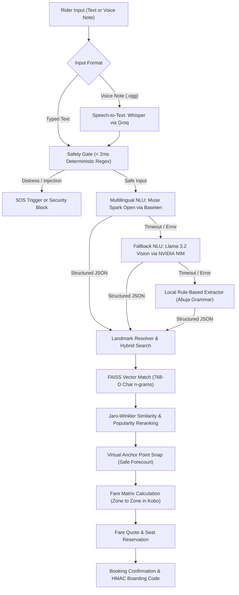
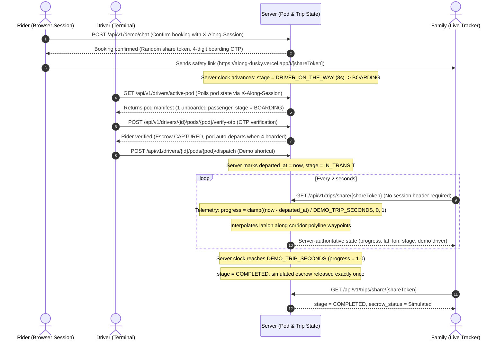

# Along: AI-Orchestrated Shared Corridor Transit for Abuja

Along is an AI-orchestrated shared transit platform that groups Abuja commuters into safe 4-seat vehicle pods loading at well-lit commercial filling stations along six major highway corridors.

| Item | Details |
|---|---|
| Live Demo | [https://along-dusky.vercel.app/](https://along-dusky.vercel.app/) (Frontend on Vercel) |
| Demo Video | <https://youtu.be/3rtguXda-4s?si=SWtNoAGN1hB4Smp4> |
| API Health | [https://along-api-i3ne.onrender.com/healthz](https://along-api-i3ne.onrender.com/healthz) (Backend on Render) |
| Track and Theme | Indie Developer, solo builder, Build for Your World |
| Repository Status | Public repository, 46 backend tests passing, frontend production build passing |

---

## Try It in Two Minutes

Follow this path to test the complete live transit flow:

1. Open the live link: [https://along-dusky.vercel.app/](https://along-dusky.vercel.app/)
2. Tap one of the sample prompt pills or type your own request in English, Nigerian Pidgin, or Hausa (for example: *"From Dutse first gate to Berger, 1 seat"* or *"Ina Bwari zan je Kasuwar Wuse kujera biyu"*).
3. Review the interactive fare quote card and click **Confirm Ride**.
4. Copy the public family tracking link displayed on the ride card (`/t/[shareToken]`).
5. Open the family tracking link in a private browser window or on a second device.
6. Open the driver view using the **Driver View** demo shortcut link to inspect the active 4-seat pod manifest.
7. Verify the rider's 4-digit boarding code (OTP) inside the driver terminal.
8. Click **Start demo drive** (or the dispatch shortcut) to depart the pod into transit.
9. Watch the family view move automatically along the corridor polyline as the server clock advances.
10. Open the **AI X-ray** panel in the bottom drawer to inspect the model id, inference provider, measured latency, and fallback status.

> **Operational Notes**:
> - The backend runs on a free Render instance that sleeps after inactivity; the first request after a long pause can take up to a minute to wake up.
> - Voice input requires HTTPS or localhost for browser microphone access.
> - Each browser session receives its own isolated demo pod through the `X-Along-Session` header.
> - Please do not input real personal identity numbers, financial secrets, or sensitive personal information.

---

## The Problem

I live in Abuja and regularly commute along the Berger, Wuse, and Banex routes. Daily transit across the Federal Capital Territory relies on informal shared taxis and minibuses. Commuters gather at unlit highway junctions, negotiate fares without price transparency, face arbitrary luggage surcharges, and wait by busy road shoulders where one-chance robberies and roadside harassment occur.

At the same time, commercial drivers waste fuel driving with empty seats or pay informal tout levies (agbero fees) at chaotic roadside motor parks. A professional driver, who is a personal friend of my father, explained how junction staging, corridor route loading, and roadside passenger negotiation operate in practice. Along was built to replace roadside haggling with structured digital coordination from well-lit commercial filling station forecourts.

---

## What It Does

Along coordinates shared corridor transit through a seven-step sequence:

1. **Conversational Booking**: Commuters submit travel requests by typing or recording voice notes in Nigerian English, Nigerian Pidgin, or Hausa.
2. **Safety Gate & Speech Transcription**: Audio voice notes are transcribed to text via Whisper on Groq. The text passes through a deterministic safety gate (< 2ms) to detect distress keywords or prompt injections.
3. **Intent & Slot Extraction**: Muse Spark Open (via Baseten) extracts the intent, pickup location, drop-off location, and requested seat count in a single merged call.
4. **Hybrid Landmark Resolution**: Colloquial place names are mapped to canonical landmarks using an exact 768-D FAISS vector search combined with Jaro-Winkler string similarity and popularity reranking.
5. **Anchor Snapping & Zone Pricing**: The pickup is snapped to a safe Virtual Anchor Point (a commercial filling station forecourt within 600m), and the fare is priced from a static 6-corridor fare matrix.
6. **Escrow Hold & Boarding Code**: The rider confirms the fare quote. The seat is locked in a simulated double-entry escrow ledger, and the system issues a unique 4-digit HMAC boarding code (OTP) and a live family tracking URL.
7. **Geofenced Verification & Telemetry**: The driver verifies the rider's 4-digit OTP within 150m of the anchor forecourt. The pod departs, and live telemetry tracks the vehicle along the corridor polyline until arrival, releasing the simulated escrow.

---

## Architecture

Detailed architecture diagrams and state models are documented in [docs/architecture.md](docs/architecture.md).

### Request Lifecycle Flowchart



### Live Trip Sequence Diagram



### State Model

- **Session and Pod Isolation**: The frontend passes a random session token in the `X-Along-Session` header (16 to 64 alphanumeric characters). Each session is assigned its own independent 4-seat pod (`POD-XXXX`). Sessions never share pods, seats, or state. Sessions idle for more than 2 hours are dropped, and total pods are capped at 500.
- **Stage Progression**: Stages are strictly derived on the server from the server clock:
  1. `WAITING_FOR_DRIVER`: Fare quote created, awaiting rider confirmation.
  2. `DRIVER_ON_THE_WAY`: Confirmed by rider; driver approaches the anchor for `DEMO_DRIVER_ARRIVAL_SECONDS` (8.0 seconds).
  3. `BOARDING`: Driver docked at the anchor forecourt awaiting OTP verification.
  4. `IN_TRANSIT`: Pod departed (triggered when 4 passengers board or via the dispatch demo shortcut).
  5. `COMPLETED`: Telemetry progress reaches 1.0; simulated escrow settles.
- **Telemetry Derivation**: Progress is calculated as `clamp((now - departed_at) / DEMO_TRIP_SECONDS, 0, 1)` with a default duration of 150.0 seconds. Latitude, longitude, and waypoint labels are interpolated along corridor coordinates. The vehicle position is simulated along the corridor; there is no real GPS tracking.
- **Escrow Settlement**: When progress reaches 1.0, the simulated double-entry ledger releases 90% of the fare to the driver and 10% to the platform. Settlement is idempotent and executes exactly once.
- **Server Volatility**: All active session state and pod allocations are held in server memory and reset whenever the Render instance restarts or sleeps.

### Measured Example Request Trace

The following trace is an excerpt from `data/replays/real_replay.json` recorded on 2026-10-29:

```json
{
  "id": "run-01",
  "locale": "pcm",
  "utterance": "Abeg I dey Dutse first gate, two seats go Berger",
  "stage": "POOLING",
  "traces": [
    {
      "stage": "extraction",
      "provider_label": "via Baseten",
      "model_id": "meta-models/muse-spark-open-1026",
      "label": "Meta open-weight model (Muse Spark Open)",
      "llm_level": "primary",
      "latency_ms": 3384.61,
      "status": "ok",
      "fallback": false
    },
    {
      "stage": "safety_guard",
      "provider_label": "via Baseten",
      "model_id": "meta-models/muse-spark-open-1026",
      "latency_ms": 3384.61,
      "status": "ok",
      "fallback": false
    }
  ],
  "quote": {
    "corridor_id": "BWR-DUT-WUS",
    "origin_name": "Dutse First Gate",
    "destination_name": "Berger Roundabout Underbridge",
    "anchor_name": "TotalEnergies Forecourt Dutse",
    "unit_fare_kobo": 90000,
    "total_fare_kobo": 180000,
    "seats": 2
  }
}
```

---

## What Runs Live and What Is Simulated

| Stage / Component | Technology & Model ID | Provider | Meta Model? | Status |
|---|---|---|---|---|
| Language Understanding | `meta-models/muse-spark-open-1026` | Baseten API | Yes (Meta open-weight) | Live |
| NLU Fallback | `meta/llama-3.2-11b-vision-instruct` | NVIDIA NIM API | Yes (Meta open-weight) | Fallback |
| Speech Recognition | `whisper-large-v3-turbo` | Groq Cloud API | No (OpenAI model; Groq used only for Whisper) | Live |
| Landmark Matching | FAISS inner-product on 768-D character n-grams with Jaro-Winkler reranking | In-process local | No (Meta open-source library) | Live |
| Safety Gate | Deterministic regex patterns (< 2ms) | In-process local | No | Live |
| Boarding OTPs | HMAC-SHA256 (30 min expiry, 5 attempt lock) | In-process local | No | Live |
| Escrow Ledger | Double-entry kobo ledger (`trial_balance == 0`) | In-process local | No | Simulated |
| Vehicle Position | Corridor polyline waypoint interpolation | In-process local | No | Simulated |
| WhatsApp Chat | Web chat interface styled as WhatsApp | Vercel (Next.js) | No | Live UI (Webhook exists, not connected to verified Meta account) |
| 2G USSD Channel | USSD state machine endpoints and test suite | Render (FastAPI) | No | Backend & tests only (Simulator removed from UI) |
| Cloud Hosting | Next.js frontend + FastAPI container | Vercel + Render | No | Live |

---

## Evaluation

Full benchmark logs, methodology, and audio clip metadata are recorded in [evals/results/eval_report.md](evals/results/eval_report.md).

### What the Results Mean

Language understanding on typed text works well across both neural and rule-based methods, correctly booking 13 of 19 requests with Muse Spark Open and 10 of 19 with deterministic rules. Speech recognition on recorded audio is the primary bottleneck in the pipeline, dropping exact booking accuracy to 2 of 19 with vocabulary hints and 1 of 19 without hints while exhibiting word error rates of 44.4% to 55.0%. Performance is heavily dependent on gazetteer coverage, succeeding on 11 of 12 in-vocabulary requests for the model but only 2 of 7 out-of-vocabulary requests where spoken place names lacked exact aliases. The rule-based path frequently asks clarifying questions when colloquial phrasing deviates from scripted patterns, leading to 7 clarification turns on booking requests compared to 4 for the model. All evaluation audio clips were collected from a small sample of 30 recordings provided by only two male speakers from the same household. Because of the small sample size and narrow acoustic distribution, these results do not claim generalization to broader commuter demographics or transit settings across Nigeria.

### Headline Evaluation Results

The evaluation dataset comprises 30 audio clips of 4 to 7 seconds recorded by the owner and the owner's brother (consenting adults; clips are stored locally outside the repository). The benchmark pool excludes 4 ambiguous or uncertain clips (c04, c07, c22, c23), leaving 26 headline clips (19 booking, 5 clarification, 2 SOS distress):

| System | Pipeline Description | Book Exact (All 3) | Book Lenient (Anchor) | Pickup Match | Drop Match | Seats Match | Clarify Success | SOS Success | WER (27 clips) | Latency p50 | Latency p95 |
|---|---|---|---|---|---|---|---|---|---|---|---|
| System A | Whisper (hint) -> Rule-based -> Resolver | 1 of 19 | 4 of 19 | 5 of 19 | 3 of 19 | 17 of 19 | 5 of 5 | 2 of 2 | 44.4% | 2197.01 ms | 2774.93 ms |
| System A-prime | Ground Truth Text -> Rule-based -> Resolver | 10 of 19 | 11 of 19 | 15 of 19 | 14 of 19 | 16 of 19 | 5 of 5 | 1 of 2 | 0.0% | 8.98 ms | 212.98 ms |
| System B (with hint) | Whisper (hint) -> Muse Spark Open -> Resolver | 2 of 19 | 5 of 19 | 6 of 19 | 6 of 19 | 17 of 19 | 5 of 5 | 2 of 2 | 44.4% | 5192.16 ms | 7110.57 ms |
| System B (no hint) | Whisper (raw) -> Muse Spark Open -> Resolver | 1 of 19 | 3 of 19 | 5 of 19 | 7 of 19 | 16 of 19 | 5 of 5 | 2 of 2 | 55.0% | 5097.54 ms | 8268.70 ms |
| System C | Ground Truth Text -> Muse Spark Open -> Resolver | 13 of 19 | 14 of 19 | 16 of 19 | 16 of 19 | 17 of 19 | 5 of 5 | 2 of 2 | 0.0% | 2353.72 ms | 3479.85 ms |

> Note: The clarify-rate table categorizes outcomes differently (classifying partial or out-of-order slot bookings under clarifying or wrong-slot categories), resulting in 9 of 19 exact matches for System A-prime and 12 of 19 for System C versus 10 and 13 in the headline table.

### Model Versus Rules on Typed Text

Comparing System C (Muse Spark Open) and System A-prime (rule-based) directly on typed ground truth text:
- Dev Split (5 booking rows): System C exact: 4 of 5; System A-prime exact: 3 of 5.
- Test Split (14 booking rows): System C exact: 9 of 14; System A-prime exact: 7 of 14.
- English (7 booking rows): System C exact: 5 of 7; System A-prime exact: 4 of 7.
- Pidgin (8 booking rows): System C exact: 5 of 8; System A-prime exact: 4 of 8.
- Hausa (4 booking rows): System C exact: 3 of 4; System A-prime exact: 2 of 4. (The Hausa subgroup consists of only 4 clips, too small to compute reliable percentages; counts are presented directly).

### In-Vocabulary Versus Out-of-Vocabulary Analysis

Accuracy was evaluated on whether both spoken locations were present in the hand-authored alias database (in-vocabulary) or not (out-of-vocabulary):

| System | In-Vocabulary (All 3 Correct) | In-Vocabulary Count | Out-of-Vocabulary (All 3 Correct) | Out-of-Vocabulary Count |
|---|---|---|---|---|
| System A | 1 of 12 | 12 | 0 of 7 | 7 |
| System A-prime | 8 of 12 | 12 | 2 of 7 | 7 |
| System B (with hint) | 2 of 12 | 12 | 0 of 7 | 7 |
| System B (no hint) | 1 of 12 | 12 | 0 of 7 | 7 |
| System C | 11 of 12 | 12 | 2 of 7 | 7 |

The model achieved 11 of 12 on in-vocabulary phrases but only 2 of 7 on out-of-vocabulary phrases, indicating that performance depends heavily on alias coverage and does not show broad generalization beyond known names.

### Clarify Rate on Headline Booking Rows

| System | Booked Correctly (Exact) | Booked with Wrong Slots | Asked Clarifying Question | Other Action (Decline) | Total Headline Book Rows |
|---|---|---|---|---|---|
| System A | 0 of 19 | 1 of 19 | 18 of 19 | 0 of 19 | 19 |
| System A-prime | 9 of 19 | 2 of 19 | 7 of 19 | 1 of 19 | 19 |
| System B (with hint) | 1 of 19 | 1 of 19 | 17 of 19 | 0 of 19 | 19 |
| System B (no hint) | 0 of 19 | 1 of 19 | 18 of 19 | 0 of 19 | 19 |
| System C | 12 of 19 | 2 of 19 | 4 of 19 | 1 of 19 | 19 |

### Cross-Corridor Trips Subgroup

Five clips involved travel across different corridors or broader zones:

| Clip | Spoken Route | System A | System A-prime | System B (hint) | System B (no hint) | System C | Valid Booking? (A-prime) |
|---|---|---|---|---|---|---|---|
| c04 | Jabi Lake Mall to Zuba interchange | clarify | clarify | clarify | clarify | clarify | N/A (clarified) |
| c06 | Kubwa Gate 1 to Wuse Zone 4 | clarify | book | clarify | clarify | book | No (wrong pickup/seats) |
| c07 | Nyanya Underbridge to Central Area | clarify | clarify | clarify | clarify | book | N/A (clarified) |
| c10 | Kubwa Arab Road to Mabushi Bridge | clarify | book | clarify | clarify | book | Yes (exact match) |
| c23 | Bridge after Gwarinpa to Central Area | clarify | clarify | clarify | clarify | clarify | N/A (clarified) |

### Frozen Benchmark Metadata

- Frozen Evaluation Commit: `39685acd752fed3f3ae57102d234188b76a509b6` (short `39685ac`).
- Safety Evaluation Finding: On typed text, the rule-based extractor recognized only 1 of 2 distress clips (listed as a known weakness under limitations).

### Reproducing the Evaluation

To execute the offline evaluation harness from the repository root:

```bash
python -m evals.harness --suite all
```

> **Note on Audio Clips**: The 30 evaluation audio clips (`data/clips/c01.ogg` through `c30.ogg`) are kept locally by the owner for privacy and are not committed to the repository. Running the full audio evaluation requires placing corresponding `.ogg` files in `data/clips/` or evaluating on the ground truth text suites.

---

## Engineering Decisions and Trade-offs

| Decision | Why | Trade-off |
|---|---|---|
| Model Fallback Chain & Request Budget | Configured with `LLM_TIMEOUT_SECONDS=12`, `LLM_FALLBACK_TIMEOUT_SECONDS=20`, and `LLM_REQUEST_BUDGET_SECONDS=30` | If the primary API experiences latency spikes, the system falls back to NVIDIA NIM and then to deterministic rules, preventing hanging requests. |
| One Merged Model Call per Turn | Combines intent detection, slot extraction, safety check, and clarification in a single JSON prompt (`extract_v1.md`) | Minimizes token cost and avoids multiple sequential network round-trips per user message. |
| Rule-Based Safety Gate Before Model | Runs deterministic regex checks in < 2ms before invoking any cloud API | Immediately intercepts emergency SOS keywords and prompt injection patterns without waiting for model latency. |
| Character n-gram Hashing Over Neural Embeddings | Uses 768-D L2-normalized feature vectors from word unigrams, bigrams, and character trigrams; no neural embedding model is loaded | Executes in < 2ms locally with zero GPU memory requirement, but cannot match complex abstract conceptual paraphrases. |
| Whisper via Groq for Speech | Meta Model API lists 25 languages that do not include Hausa or Nigerian Pidgin, and payment hold blocked activation; Groq Whisper provides fast speech transcription | Relies on an external non-Meta model for speech-to-text, and word error rates on West African accents remain high (~44.4%). |
| Server-Authoritative State with Polling | Server derives stages, progress, and positions from a server clock (`departed_at`); family tracker polls every 2 seconds | Guarantees that rider, driver, and family views agree exactly across devices without WebSocket synchronization overhead. |
| In-Memory Demonstration State | Fast prototype development without external database connection requirements | Active pods, rides, and ledger entries reset whenever the free Render instance sleeps or redeploys. |
| Per-Session Pod Allocations | Validates `X-Along-Session` (16 to 64 chars) to assign isolated 4-seat pods per browser session | Multiple hackathon judges can test the full booking, boarding, and driving lifecycle simultaneously without data collisions. |
| Rate Limits & Upload Caps | Rate limits configured to 20 requests/hour per IP, 400 requests/day globally; audio uploads capped at 5MB | Protects inference budgets and prevents denial-of-service on free cloud tiers. |
| Cryptographic Boarding Codes & Random Links | Boarding codes generated per trip and verified using HMAC-SHA256 with pepper; share tokens use `secrets.token_urlsafe` | Prevents token prediction, enumeration attacks, and unauthorized tracking. |
| 4-Seat Pod Capacity with HTTP 409 | Rejects requests exceeding remaining free seats with a localized error message | Strictly enforces the 4-passenger commercial vehicle constraint. |
| Persistent Offline Sample Banners | When the backend is unreachable or times out, the frontend displays an explicit offline banner and Retry button | Prevents mock sample text from being mistaken for live model inference output. |

### What Did Not Work

1. **Muse Glimmer Latency**: Muse Glimmer was initially tested on NVIDIA NIM's free endpoint. Because its internal reasoning output could not be disabled via API flags, every inference call took between 30 and 60 seconds, which was completely unacceptable for interactive conversational chat. It was replaced with Muse Spark Open via Baseten, which answered in approximately 2.5 to 3.4 seconds with `reasoning_effort: "low"`.
2. **Speech Recognition on Colloquial Transit Speech**: Off-the-shelf Whisper ASR struggled significantly with Nigerian English, Nigerian Pidgin, and Hausa commuter place names (e.g., transcribing "Dutse Alhaji" as "Duse Aladji", and "Wuse Zone 4" as "two season four"), yielding word error rates between 44.4% and 55.0% and reducing end-to-end voice booking accuracy to 2 of 19.

---

## Reliability and Failure Modes

| Failure Mode | What the User Sees | What the System Does |
|---|---|---|
| Model Timeout (> 12s) | Conversational response arrives normally without error; AI X-ray indicates fallback status | The client times out after 12s, tries the secondary model (NVIDIA NIM), and falls back to the deterministic local rule-based extractor. |
| Rate Limit Exceeded | Error banner: *"Rate limit exceeded. Please wait before sending another message."* | The backend returns HTTP 429 with RFC 9457 Problem Details (`RATE_LIMIT_EXCEEDED`). |
| Backend Asleep (Cold Start) | UI shows a loading indicator; initial turn may take up to 60 seconds | Render spins up the container. An external UptimeRobot monitor pings `/healthz` every 5 minutes to minimize sleep events. |
| Backend Restart / Redeploy | If an old tracking link is opened, UI displays *"Trip not found"* with a button to book a new ride | The backend returns HTTP 404 with error code `TRIP_NOT_FOUND` because in-memory pods reset on restart. |
| Unknown / Invalid Trip Token | UI displays *"Trip not found"* and offers a link back to the homepage | Endpoint returns HTTP 404 with `{"code": "TRIP_NOT_FOUND", "message": "This trip is no longer available. The demo server may have restarted. Book a new ride."}`. |
| Microphone Permission Blocked | Browser error notification prompting to allow microphone access | Voice recording stops; the user is prompted to type their request or allow microphone access in browser settings. |
| Empty Seats at Departure | Driver cockpit shows unboarded seats; manual dispatch shortcut allows departure with at least 1 boarded rider | If dispatch is attempted with 0 boarded riders, backend returns HTTP 409: *"Cannot start trip: at least one passenger must be boarded before departing."* |

---

## Security and Privacy

- **Boarding Code Security**: 4-digit boarding OTPs are never stored in plain text. They are hashed using HMAC-SHA256 with a secret pepper (`OTP_PEPPER`) and bound to the specific request ID. OTPs expire after 30 minutes and lock permanently after 5 consecutive incorrect attempts (HTTP 429).
- **Session Isolation**: Every browser session provides an `X-Along-Session` header (16 to 64 alphanumeric or hyphen characters). Pods, rides, and manifests are completely isolated per session.
- **CORS Policy**: Configured using explicit allowlists (`CORS_ALLOWED_ORIGINS`). `X-Along-Session` is exposed and permitted in CORS preflight `OPTIONS` requests.
- **Rate Limiting & File Size Caps**: Configured to 20 requests/hour per IP, 400 requests/day globally. Audio payload size is strictly capped at 5MB (`413 Payload Too Large`).
- **Secret Hygiene**: Zero secret API keys or credentials are stored in the repository. All secrets are loaded from environment variables. Staged files are scanned for API key prefixes and known secret patterns.
- **Privacy & External APIs**: Demonstration data uses synthetic driver profiles and simulated passenger names. Voice audio is sent to Groq for speech-to-text, and conversational text is sent to Baseten for NLU. No audio is persisted to disk on cloud servers.
- **Safety Disclaimer**: Along does not claim to guarantee physical safety. The SOS feature is an interactive demonstration marker that records distress status in the active pod manifest; it does not dispatch emergency services or contact law enforcement. **In a real emergency in Nigeria, call 112.**

---

## Testing and Continuous Integration

### Backend Test Suite

The backend test suite is executed using `pytest`:

```bash
cd backend
pytest tests/ -v
```

All 46 automated backend tests pass (0 failures, 0 errors, 1 warning):
- `tests/integration/test_capacity_and_otp.py`: 4-seat capacity enforcement, Pidgin/Hausa 409 responses, unique seat allocation, seat reuse on alighting, and auto request_id OTP resolution.
- `tests/integration/test_lua_atomicity.py`: Redis atomic Lua scripts for seat acquisition and rollback invariants.
- `tests/integration/test_otp_security.py`: HMAC constant-time OTP verification, pepper isolation, 30-minute expiration, and 5-attempt lockout.
- `tests/integration/test_phase3_whatsapp_and_escrow.py`: WhatsApp webhook HMAC verification, idempotency, and double-entry ledger settlement.
- `tests/integration/test_phase4_and_5_dispatch_ussd_ops.py`: Driver KYC vehicle photo check, 150m anchor geofence verification, USSD session state machine, and public trip share SOS.
- `tests/integration/test_phase6_evals_and_stress.py`: Evaluation harness gates, landmark retrieval accuracy, and synthetic load checks.
- `tests/unit/test_ai_layer.py`: LLM client fallback chain, token sanitization, and rule-based grammar extraction.
- `tests/unit/test_core_primitives.py`: Haversine distance calculations, corridor directional inference, and anchor snapping.
- `tests/unit/test_ledger_invariants.py`: Double-entry balanced ledger proofs (`sum(debits) == sum(credits)`), kobo rounding, and escrow release idempotency.
- `tests/unit/test_migrations_and_seeds.py`: Verification of 142 landmarks, 24 anchors, 6 corridors, and 75 fare matrix seed rows.
- `tests/unit/test_rate_limiter.py`: In-memory sliding window IP rate limiting and global quotas.
- `tests/unit/test_server_authoritative_trips.py`: Server clock stage progression, monotonic telemetry, isolated session pods, 409 capacity limit, OTP lockout, and CORS header preflights.

### Continuous Integration (GitHub Actions)

The `.github/workflows/ci.yml` pipeline runs on every push and pull request to `main`:
1. `backend-checks`: Sets up Python 3.12, installs dependencies, and runs `pytest tests/ -v`.
2. `frontend-checks`: Sets up Node.js 20, runs `npm ci`, and executes `npm run build`.

> Note: The non-blocking interactive lint step was removed in commit `f8ec0b3`.

### What Is Not Tested

- Real-world voice audio quality across noisy vehicle engines and diverse mobile phone microphones.
- Physical feature phone 2G telecom hardware for USSD and IVR carrier integrations.
- Concurrency and stress loads exceeding 50 simultaneous browser connections.

---

## API Overview

Detailed request schemas, headers, response fields, and error codes are specified in [docs/API_CONTRACT.md](docs/API_CONTRACT.md).

| Method | Path | Summary | Contract Link |
|---|---|---|---|
| `POST` | `/api/v1/demo/chat` | Process conversational booking turn, generate quote, and return AI X-ray | [API Contract Section 3.1](docs/API_CONTRACT.md#31-chat--booking) |
| `GET` | `/api/v1/trips/share/{share_token}` | Public zero-login trip telemetry, server-derived stage, position, and driver badge | [API Contract Section 3.3](docs/API_CONTRACT.md#33-public-trip-tracking) |
| `POST` | `/api/v1/trips/share/{share_token}/sos` | Trigger emergency distress marker on active trip | [API Contract Section 3.4](docs/API_CONTRACT.md#34-trip-sos-emergency-trigger) |
| `GET` | `/api/v1/drivers/active-pod` | Driver cockpit manifest, passenger seat assignments, and pod stage | [API Contract Section 3.5](docs/API_CONTRACT.md#35-driver-active-pod-manifest) |
| `POST` | `/api/v1/drivers/{driver_id}/pods/{pod_id}/verify-otp` | Verify rider 4-digit boarding code within 150m anchor geofence | [API Contract Section 3.6](docs/API_CONTRACT.md#36-driver-verify-boarding-otp) |
| `POST` | `/api/v1/drivers/{driver_id}/pods/{pod_id}/dispatch` | Manually dispatch pod into transit (requires at least 1 boarded rider) | [API Contract Section 3.7](docs/API_CONTRACT.md#37-driver-early-dispatch) |
| `POST` | `/api/v1/drivers/{driver_id}/pods/{pod_id}/fill-coriders` | Demo shortcut to fill remaining pod seats with simulated co-riders | [API Contract Section 3.8](docs/API_CONTRACT.md#38-driver-fill-simulated-co-riders) |
| `POST` | `/api/v1/drivers/active-pod/reset` | Reset active session pod back to standby | [API Contract Section 3.9](docs/API_CONTRACT.md#39-reset-active-pod) |
| `GET` | `/api/v1/ops/overview` | Command center telemetry, ledger audit balance, and 6-corridor metrics | [API Contract Section 3.10](docs/API_CONTRACT.md#310-ops-command-center-overview) |
| `GET` | `/healthz` | Lightweight health check probe returning version and service status | [API Contract Section 3.11](docs/API_CONTRACT.md#311-health-check) |

---

## What We Built During the Hackathon

Compliance records, timestamps, and owner disclosures are detailed in [docs/HACKATHON_COMPLIANCE.md](docs/HACKATHON_COMPLIANCE.md):

- **Event Build Window**: October 26, 2026 to November 4, 2026 (Meta Global AI Developer Hackathon).
- **Pre-Event Planning Material**: Two design documents were drafted before the build window began: `docs/archive/MASTER_IMPLEMENTATION_PLAN.md` (created 2026-10-23) and `docs/archive/PITCH_DECK.md` (created 2026-10-26 10:34 WAT). Neither contained application code. Both were archived in `docs/archive/`.
- **Implementation Commits**: All source code, API routes, database migrations, matching logic, and frontend components were created after October 26 at 11:09 WAT.
- **AI Tooling Disclosure**: Code was written with AI coding assistants (Claude and Gemini models inside the Antigravity IDE) directed by the owner. The owner guided the architecture, reviewed outputs, ran tests, recorded and labeled the evaluation clips, and directed all product decisions.
- **Contribution Map**: See Section 5 of [docs/HACKATHON_COMPLIANCE.md](docs/HACKATHON_COMPLIANCE.md) for full commit mappings across AI pipeline, FAISS index, double-entry ledger, driver matching, and web components.

---

## Data and Credits

Data provenance and third-party license audits are documented in [docs/DATA_PROVENANCE.md](docs/DATA_PROVENANCE.md) and [docs/THIRD_PARTY.md](docs/THIRD_PARTY.md):

- **Seed Data**: 142 landmarks, 1,122 unique street aliases, 24 Virtual Anchor Points, 6 corridor trunks, and 75 fare matrix rows were compiled from first-hand commuting experience along the Berger, Wuse, and Banex routes, informal consultations with a commercial driver, and rider feedback.
- **Data Limits**: Coordinates and route markers have uniform 4-decimal precision (approximately 11m resolution). They are hand-curated map pin coordinates, not survey-grade GIS tracks. Fares represent illustrative informal transit rates.
- **OpenStreetMap Usage**: OpenStreetMap was not used to produce seed files and is not queried at runtime. `backend/scripts/fetch_osm_abuja.py` is an offline coordinate validator.
- **Libraries and Fonts**: Permissive open-source libraries (FastAPI, Uvicorn, Pydantic, RapidFuzz, Next.js, React under MIT/BSD/Apache-2.0). Web fonts (`Bricolage Grotesque`, `Instrument Sans`, `JetBrains Mono`) are licensed under the SIL Open Font License 1.1.
- **Disclaimer**: Along is an independent project and is not affiliated with or endorsed by WhatsApp or Meta.

---

## Honest Limitations

1. **In-Memory Volatility**: Active demonstration state (session pods, bookings, escrow balances) is held in memory and resets whenever the free Render instance restarts or sleeps.
2. **Simulated Payments and Vehicle GPS**: Escrow settlements and vehicle positions are simulated along corridor waypoints; there is no live banking integration or hardware GPS tracker.
3. **No Live WhatsApp Business Account**: The interface is a web simulation styled like WhatsApp. A webhook handler exists in code but is not connected to a verified Meta Business WhatsApp account.
4. **Speech Model is Not Meta**: Speech recognition uses Whisper via Groq because the Meta Model API does not support Hausa or Nigerian Pidgin.
5. **Small Evaluation Dataset**: Benchmarks were performed on 30 short audio clips recorded by two male speakers from the same household. Results indicate directional trends and do not claim generalization.
6. **ASR Error Rates on Nigerian Accents**: Whisper exhibited high word error rates (~44.4% to 55.0%) on Pidgin and Hausa, making speech recognition the primary bottleneck in the voice pipeline.
7. **Free-Tier Cold Starts**: The backend runs on a free Render service that sleeps after inactivity; initial cold starts can take up to 60 seconds.
8. **Safety Gate Coverage**: In offline evaluations, the deterministic rule-based safety gate recognized only 1 of 2 distress clips on typed text.
9. **Offline Sample Labels**: If the live backend is unreachable, the frontend displays pre-recorded sample responses clearly labeled *"Sample response (offline)"* with a persistent warning banner.

---

## Production Path and Roadmap

To transition Along from a hackathon demonstration to a production transit platform:

### Infrastructure & Engineering
- **Persistent Storage**: Replace in-memory dictionaries with managed PostgreSQL (Supabase) and Redis clusters for pod manifests, trip state, and ledger entries.
- **Real-Time Push**: Transition frontend polling to Server-Sent Events (SSE) or WebSockets for instant vehicle movement updates.
- **Physical GPS Telemetry**: Connect driver GPS locations via a dedicated driver mobile app with map-matching algorithms.
- **Live Payments**: Integrate licensed Nigerian payment processors (Paystack or Flutterwave) for bank transfers and USSD wallet funding.
- **Verified WhatsApp Business Account**: Connect the existing webhook handler to a registered Meta Business Account using the WhatsApp Cloud API.
- **Observability**: Deploy OpenTelemetry distributed tracing and structured Prometheus metrics across all microservices.

### Meta-Related Roadmap
- **Muse Voice Transcribe**: Benchmark Meta's native speech recognition models on Nigerian English, Pidgin, and Hausa as language support expands.
- **Meta SAM 3.1 Vehicle Checks**: Deploy Segment Anything (SAM 3.1) in the driver KYC pipeline to automate vehicle body inspection and 4-seat interior passenger verification.
- **Two-Step Transcript Confirmation**: Implement an explicit user verification step before booking to allow commuters to correct speech recognition errors.

---

## Run It Locally

### Prerequisites

- Python 3.11 or 3.12
- Node.js 20 or higher
- Git

### 1. Clone Repository

```bash
git clone https://github.com/AhmadCM01/Along.git
cd Along
```

### 2. Environment Configuration

Copy the example environment configuration:

```bash
# Windows (PowerShell)
Copy-Item .env.example .env

# macOS / Linux (Bash)
cp .env.example .env
```

Configure the following environment variable names in `.env` (never commit secret values):
- `LLM_BASE_URL`: Inference endpoint URL (e.g. Baseten)
- `LLM_API_KEY`: API key for primary NLU model
- `LLM_MODEL`: `meta-models/muse-spark-open-1026`
- `LLM_PROVIDER_LABEL`: `baseten_meta_ai`
- `LLM_FALLBACK_BASE_URL`: Optional secondary inference URL (e.g. NVIDIA NIM)
- `LLM_FALLBACK_API_KEY`: Optional secondary API key
- `LLM_FALLBACK_MODEL`: `meta/llama-3.2-11b-vision-instruct`
- `GROQ_API_KEY`: API key for Whisper speech transcription
- `JWT_SECRET_KEY`: 64-character hexadecimal signing string
- `OTP_PEPPER`: 64-character hexadecimal pepper string

### 3. Start Backend

```bash
# Windows (PowerShell)
cd backend
python -m venv .venv
.venv\Scripts\Activate.ps1
pip install -e ".[dev,ai]"
python -m uvicorn app.main:app --host 0.0.0.0 --port 7860 --reload

# macOS / Linux (Bash)
cd backend
python3 -m venv .venv
source .venv/bin/activate
pip install -e ".[dev,ai]"
uvicorn app.main:app --host 0.0.0.0 --port 7860 --reload
```

Backend health probe: [http://localhost:7860/healthz](http://localhost:7860/healthz)

### 4. Start Frontend

```bash
# In a separate terminal
cd frontend
npm install
npm run dev
```

Frontend interface: [http://localhost:3001](http://localhost:3001)

### 5. Run Automated Tests & Evaluations

```bash
# Run 46 backend unit and integration tests
cd backend
pytest tests/ -v

# Run offline NLU evaluation harness
python -m evals.harness --suite all
```

### 6. Cloud Deployment

See [deploy/README.md](deploy/README.md) for full instructions on deploying the FastAPI service to Render and the Next.js frontend to Vercel.

---

## Repository Map

```
Along AI/
├── backend/            # FastAPI application, AI inference pipeline, and matching engine
│   ├── app/ai/         # NLU extraction, LLM fallback chain, ASR, and FAISS landmark hybrid search
│   ├── app/api/v1/     # REST endpoints for chat, driver manifest, public tracking, and ops
│   ├── app/core/       # Domain config, rate limiting, security, and authoritative trip state
│   ├── app/db/         # Double-entry ledger models and database repositories
│   ├── app/matching/   # Pod formation, 600m anchor snapping, and dispatch logic
│   ├── scripts/        # Seed loading, landmark index builder, and benchmark scripts
│   └── tests/          # 46 automated integration and unit tests
├── data/               # Corridor GeoJSON polylines, FAISS index artifacts, and session replays
├── deploy/             # Render and Vercel cloud deployment guides
├── docs/               # System architecture, API contracts, compliance disclosures, and image specs
│   ├── archive/        # Archived pre-event planning documents (PITCH_DECK and MASTER_PLAN)
│   └── images/         # Screenshot specification and image placeholders
├── evals/              # NLU evaluation harness, prompts, and benchmark report files
├── frontend/           # Next.js 15 web application and simulated WhatsApp interface
│   └── src/            # React components, live family tracker, driver terminal, and icons
├── scripts/            # PowerShell local network development scripts
├── supabase/seed/      # Canonical seed CSV files (142 landmarks, 24 anchors, 6 corridors, fares)
└── Makefile            # Shortcut commands for testing, linting, and index generation
```

---

## License

<No license has been chosen yet. All rights reserved by the author.>
