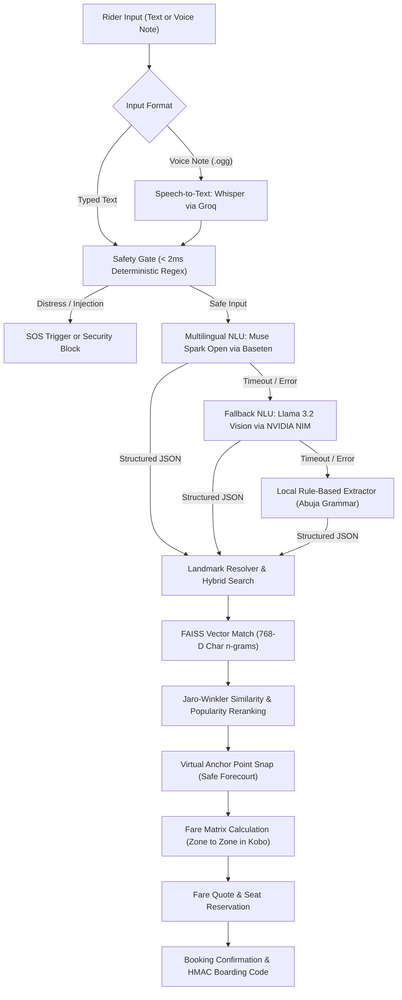
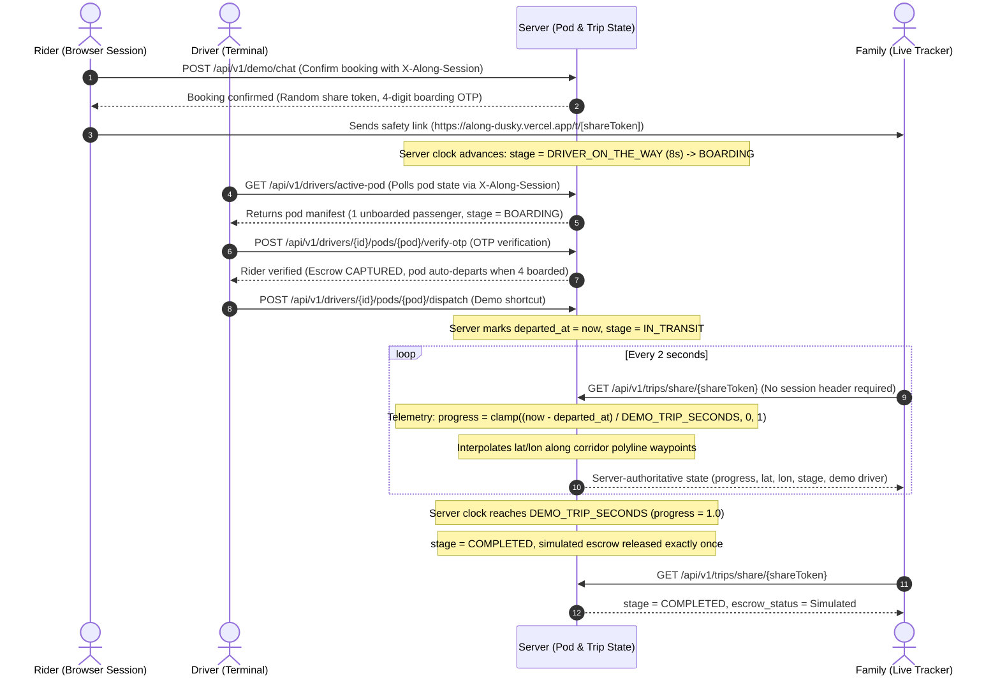

# Along System Architecture

This document describes the request lifecycle, runtime inference chain, and server-authoritative trip state model for Along.

---

## 1. Request Lifecycle Flowchart

The following flowchart illustrates how conversational rider requests (text or voice) flow through speech recognition, deterministic safety guardrails, the multilingual language understanding fallback chain, hybrid spatial landmark resolution, and booking confirmation:

---

## 2. Live Trip Sequence Diagram

The sequence diagram below shows how the server clock serves as the single source of truth for pods, stages, and telemetry, with driver terminals, rider ride cards, and family trackers polling the same backend state:

---

## 3. State Model Summary

- **Session and Pod Isolation**: Each browser session generates an `X-Along-Session` header (16 to 64 characters of `[A-Za-z0-9-]`). The server assigns each session a distinct 4-seat pod (`POD-XXXX`). Sessions never share pods, seats, or state. Idle sessions (inactive for over 2 hours) are evicted, and active pods are capped at 500.
- **Stage Progression**: Stages are derived deterministically on the server: `WAITING_FOR_DRIVER` (unconfirmed quote) -> `DRIVER_ON_THE_WAY` (8 seconds after confirmation) -> `BOARDING` (driver docked at safe anchor forecourt) -> `IN_TRANSIT` (pod departed) -> `COMPLETED` (progress reaches 1.0).
- **Telemetry Derivation**: Vehicle progress is computed as `clamp((now - departed_at) / DEMO_TRIP_SECONDS, 0, 1)`. Latitude and longitude are interpolated along corridor waypoints between pickup and drop-off.
- **Simulated Escrow Release**: When progress reaches 1.0, simulated escrow settlement releases 90% to the driver and 10% to the platform. The release operation is strictly idempotent.
- **In-Memory Volatility**: Demonstration state resides in server memory and resets whenever the free Render instance restarts or redeploys.
